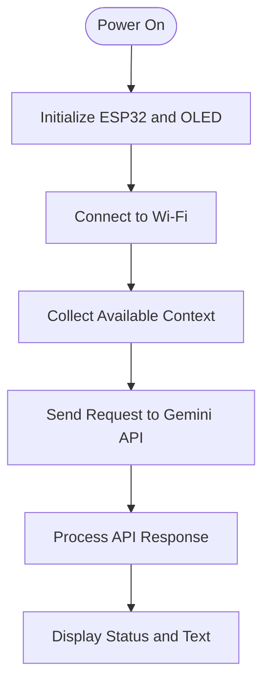

🚗 Direction-Aware Smart Vehicle
An ESP32-Based Smart Vehicle Platform with AI-Assisted Guidance

  
  
  
  

<em>Bringing embedded systems, connected services, and vehicle electronics together in one project.</em>

📌 Overview
Direction-Aware Smart Vehicle is an ESP32-based embedded-systems project that combines wireless connectivity, a compact OLED interface, orientation-sensing hardware, and Google Gemini API integration. It provides a foundation for exploring connected vehicle systems and AI-assisted guidance through a microcontroller-based platform.

The repository contains the Arduino firmware, a hardware reference diagram, and the project visuals needed to understand the system layout.
✨ Key Features
<table>
  <tr>
    <td width="50%"><strong>🧠 ESP32 Control</strong> Central controller for embedded application logic and peripheral coordination.</td>
    <td width="50%"><strong>🧭 Orientation Hardware</strong> Compass module included in the hardware design for heading-related input.</td>
  </tr>
  <tr>
    <td><strong>📟 OLED Interface</strong> 128×64 SSD1306 display for system status and text output.</td>
    <td><strong>📡 Wireless Connectivity</strong> Wi-Fi connectivity for network-based features and API communication.</td>
  </tr>
  <tr>
    <td><strong>✨ AI-Assisted Responses</strong> Gemini API integration for generating text responses.</td>
    <td><strong>🔧 Modular Hardware Design</strong> Reference layout covering sensing, audio, motor-driver, and vehicle components.</td>
  </tr>
</table>

🏗️ System Architecture
The ESP32 acts as the central controller, coordinating the display, network connection, and application logic. The system can be understood as a sequence of initialization, context collection, network communication, response processing, and user-facing output.

🧰 Hardware Components
Component	Role in the System
ESP32 DevKit V1	Main microcontroller with Wi-Fi connectivity
SSD1306 OLED, 128×64	Displays system status and text
QMC5883 Compass Module	Heading and orientation sensing
MAX98357A I²S Amplifier + Speaker	Audio output hardware
INMP441 Microphone Module(s)	Audio input hardware
L298N Motor Driver	Interface for DC motor control
DC Motors and Chassis	Vehicle platform and movement hardware
Power Supply / Regulator	Provides suitable power to system modules

Hardware note: Confirm the exact modules, voltage levels, current requirements, and wiring against your physical build and each component's datasheet before powering the circuit.

💻 Software Stack
- Firmware: C++ with the Arduino framework
- Microcontroller: ESP32
- Display libraries: Adafruit SSD1306 and Adafruit GFX
- JSON processing: ArduinoJson
- Connectivity: ESP32 Wi-Fi, HTTP, and secure-client libraries
- AI service: Google Gemini API
- Development environment: Arduino IDE or a compatible ESP32 toolchain
📁 Repository Structure
Direction-Aware-Smart-Vehicle/
├── docs/
│   └── direction aware.png   # Hardware wiring / system diagram
├── src/
│   └── main.ino              # ESP32 firmware
├── smart vehicle.png         # Project image
└── README.md                 # Project documentation
⚙️ Getting Started
Prerequisites
- ESP32 development board and USB data cable
- Arduino IDE with ESP32 board support installed
- A Wi-Fi network
- A Google Gemini API key
- The libraries listed in the next section
Install the Required Libraries
Install the following through the Arduino IDE Library Manager:
- Adafruit GFX Library
- Adafruit SSD1306
- ArduinoJson
- ESP8266Audio, for compatible audio classes used by the sketch
The ESP32 board package provides the Wi-Fi, I²C, HTTP, and secure-client functionality used by the firmware.
Configure Credentials
Create a local secrets.h file beside main.ino and add your own settings:
#pragma once

#define WIFI_SSID "YOUR_WIFI_NAME"
#define WIFI_PASSWORD "YOUR_WIFI_PASSWORD"
#define GEMINI_API_KEY "YOUR_GEMINI_API_KEY"
#define GEMINI_MODEL "YOUR_SUPPORTED_GEMINI_MODEL"
#define TTS_WAV_URL_BASE ""
Replace the example values with your own credentials and a Gemini model available to your API project. Never commit real Wi-Fi passwords or API keys to a public repository. Keep secrets.h local and add it to .gitignore.
Clone, Build, and Upload
git clone https://github.com/harshit6043/Direction-Aware-Smart-Vehicle.git
cd Direction-Aware-Smart-Vehicle
1. Open src/main.ino in the Arduino IDE.
2. Select the appropriate ESP32 board and connected serial port.
3. Install the required libraries and create secrets.h.
4. Compile and upload the sketch to the board.
5. Open Serial Monitor at 115200 baud to view diagnostic output.
🔌 Pin Configuration
Signal	GPIO / Value
OLED SDA	GPIO 21
OLED SCL	GPIO 22
OLED I²C Address	0x3C
I²S Bit Clock (BCLK)	GPIO 26
I²S Word Select (LRC)	GPIO 25
I²S Data Out (DOUT)	GPIO 27

Verify pin assignments against the source code and your actual wiring before connecting peripherals.
🖼️ Hardware Reference

Hardware and wiring reference diagram

🔐 Safety and Configuration Notes
- Keep credentials in a local configuration file and out of public commits.
- Check polarity, voltage levels, and power requirements before connecting modules.
- Do not power motors directly from ESP32 GPIO pins. Use a suitable motor driver and an appropriately rated supply.
- Validate any AI-generated guidance before using it in a physical control system.
- For deployment, enable proper HTTPS certificate verification.
🚀 Future Enhancements
- Compass calibration and refined heading processing
- Integrated audio input and voice output
- Expanded motor-control and movement logic
- Improved network recovery and diagnostic reporting
- Additional hardware validation, test records, and circuit documentation
🤝 Contributing
Suggestions and improvements are welcome. Keep contributions focused, document hardware assumptions, and include setup or test details when changing the firmware or circuit design.
